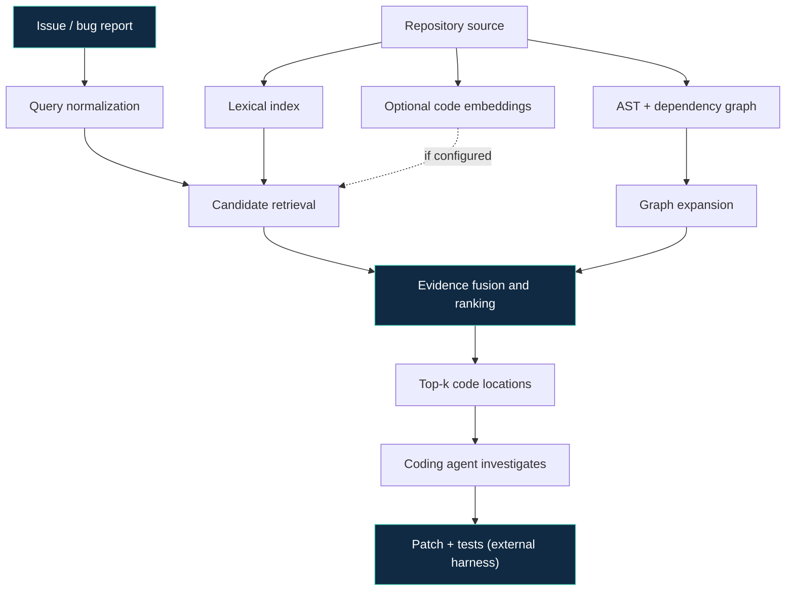

<div align="center">

<a href="https://github.com/Nersu-Abhinav/beyond-similarity">
  
</a>

<p><strong>Repository-aware retrieval research for reliable AI software engineering.</strong></p>

<p>
  <a href="https://github.com/Nersu-Abhinav/beyond-similarity/actions/workflows/tests.yml"></a>
  <a href="https://github.com/Nersu-Abhinav/beyond-similarity/blob/main/LICENSE"></a>
  <a href="https://www.python.org/"></a>
  <a href="https://www.kaggle.com/competitions/gemma-4-developer-agent-paper"></a>
  
</p>

<p>
  <a href="#-quick-start">Quick start</a> •
  <a href="#-how-it-works">How it works</a> •
  <a href="#-model-strategy">Model strategy</a> •
  <a href="#-evaluation">Evaluation</a> •
  <a href="#-roadmap">Roadmap</a>
</p>

</div>

---

## ✦ The idea

Coding agents can retrieve code that *sounds* relevant while missing the functions that actually control the behavior. **Beyond Similarity** explores a simple research hypothesis: combine lexical evidence with repository structure—and optional semantic embeddings—to help an agent find the right code before it attempts a fix.

The project is built to be inspectable and reproducible. It includes a dependency-free lexical baseline, graph-aware reranking, a Python source indexer, optional embedding support, ranking metrics, a command-line interface, and automated tests.

> **Research integrity:** this repository is an implementation prototype, not evidence of a benchmark win. The bundled tasks are synthetic smoke tests. Real benchmark results must be measured and reported before claiming improvements.

## ✨ Highlights

| Capability | What it does |
|---|---|
| 🔎 Lexical retrieval | IDF-weighted token matching as a transparent baseline |
| 🕸️ Graph-aware ranking | Uses bounded dependency proximity to rerank candidates |
| 🐍 Python AST indexing | Extracts functions, classes, methods, and call relationships from local Python files |
| 🧠 Optional semantic retrieval | Uses a pinned Sentence Transformers model when installed; works without it otherwise |
| 📊 Ranking metrics | Recall@k, Precision@k, MRR, and per-query latency |
| 🧪 Reproducible evaluation | Runs lexical and graph-guided variants on the same tasks |
| ⚙️ Lightweight core | Python standard library for core retrieval and tests |
| 🔁 Continuous integration | GitHub Actions runs unit tests and smoke checks |

## 🧭 How it works



### Retrieval score

The interpretable graph-guided baseline combines lexical relevance (L) and graph proximity (G):

`score(c,q) = (1 - λ) · L(c,q) + λ · G(c,q)`

- (q): issue or natural-language query.
- (c): candidate code component.
- (L): normalized IDF-weighted lexical score.
- (G): bounded shortest-path proximity from lexical seed candidates.
- (λ): graph weight, which must be selected on development data and frozen before test evaluation.

When configured, semantic similarity is available as an additional retrieval signal. Do not describe the current default baseline as a neural embedding model.

## 🚀 Quick start

**Requirements:** Python 3.10 or newer.

```bash
git clone https://github.com/Nersu-Abhinav/beyond-similarity.git
cd beyond-similarity

# Run the test suite
python -m unittest discover -s tests -v

# Run a self-contained smoke test
python -m beyond_similarity.cli demo

# Evaluate the bundled synthetic fixture
python -m beyond_similarity.cli evaluate --data data/example_tasks.json --output results.json
```

The core implementation has no required third-party runtime dependencies. The sample data is deliberately small and synthetic; it only checks that the pipeline executes.

### Search a real local Python repository

Run a query against the current directory or a project path:

```bash
# Rank functions/classes with the graph-aware baseline
python -m beyond_similarity.cli search-python --root /path/to/project --query "handle invalid authentication token" --k 10

# Use lexical ranking only
python -m beyond_similarity.cli search-python --root /path/to/project --query "parse configuration" --method lexical

# Export the AST index and approximate dependency edges
python -m beyond_similarity.cli index-python --root /path/to/project --output source-index.json

# Optional: fuse semantic embeddings with lexical and graph evidence
pip install -e ".[semantic]"
python -m beyond_similarity.cli search-python --root /path/to/project --query "retry failed database connection" --semantic
```

Treat retrieved candidates as leads for inspection, not as proof that a component contains a bug. AST call edges are approximate and cross-file resolution is not complete.

## 🧠 Model strategy: the right model for the right job

This repository separates **retrieval** from **patch generation**. That keeps experiments reproducible and lets the coding model focus its context on the most relevant code.

### Recommended competition agent

For the official **Google – Gemma 4 Developer Agent Competition**, the published rules specify the model variant `gemma-4-31b-it-qat-w4a16-ct` for every agent and subagent. Use that exact supported variant in the official Kaggle harness, not an arbitrary replacement. Check the current rules before submission because organizers may update them.

- [Official developer-agent competition](https://www.kaggle.com/competitions/gemma-4-developer-agent)
- [Official paper track](https://www.kaggle.com/competitions/gemma-4-developer-agent-paper)
- [Gemma model documentation](https://ai.google.dev/gemma/docs)

### Semantic retrieval option

To add a local semantic signal, install the optional extra and choose a model that fits the available environment:

```bash
pip install -e ".[semantic]"
```

Default optional encoder: `sentence-transformers/all-MiniLM-L6-v2`. It is a small general-purpose text encoder for a reproducible local experiment—not a code-specialized model and not the Gemma coding agent. For serious benchmark runs, compare it with a code-aware encoder using the same split, candidate budget, and evaluation protocol. Pin model revisions and cache embeddings to keep runs reproducible.

**Competition note:** if the official harness provides precomputed code embeddings and graph tools, prefer using those permitted resources instead of downloading a separate encoder at inference time. The competition evaluation environment may disable internet access.

### Why no model weights are committed?

Model weights are large, hardware-dependent artifacts and may have separate distribution terms. Keep the repository light; document exact model IDs and versions, and store allowed adapters or weights as separately versioned Kaggle resources when needed.

## 📦 Repository layout

```text
beyond-similarity/
├── beyond_similarity/
│   ├── __init__.py
│   ├── retrieval.py       # lexical baseline + graph-aware ranking
│   ├── metrics.py         # retrieval evaluation metrics
│   ├── source_index.py    # Python AST and call-graph extraction
│   ├── semantic.py        # optional embedding retrieval
│   └── cli.py             # demo and evaluation CLI
├── data/
│   └── example_tasks.json # synthetic smoke-test fixture only
├── docs/
│   └── EXPERIMENTAL_PROTOCOL.md
├── tests/
├── .github/workflows/
├── CITATION.cff
├── LICENSE
├── pyproject.toml
└── README.md
```

## 🧪 Data format

Each task is a JSON object (or a JSONL record):

```json
{
  "task_id": "example-001",
  "query": "Reject malformed input in the parser",
  "nodes": [
    {"id": "parser", "name": "parse_input", "text": "Parse input and call validation"},
    {"id": "validator", "name": "validate_input", "text": "Reject missing or malformed values"}
  ],
  "edges": [["parser", "validator"]],
  "relevant_ids": ["validator"]
}
```

- `nodes`: searchable source components with stable IDs.
- `edges`: relationships between components. The current graph proximity implementation treats edges as undirected.
- `relevant_ids`: labels used **only by evaluation**, never by candidate ranking.

See [the experimental protocol](docs/EXPERIMENTAL_PROTOCOL.md) before using any dataset for paper claims.

## 📊 Evaluation

Run a dataset you have permission to use:

```bash
python -m beyond_similarity.cli evaluate --data path/to/tasks.json --k 1 5 10 --output results.json
```

The output includes per-task rankings, macro-averaged metrics, and timing. Record the environment and commit SHA for every reported run.

### Required comparisons

1. Lexical baseline.
2. Semantic-only retrieval with a fixed encoder.
3. Graph-only retrieval with a clearly specified candidate-generation method.
4. Lexical + semantic hybrid.
5. Graph-guided hybrid.
6. Ablations for graph weight, graph depth, and candidate budget.

Report Recall@1/5/10, Precision@1/5/10, MRR, latency, task count, and uncertainty where possible. If a benchmark supports patch execution, report patch pass rate separately from localization metrics.

| Result category | Current status |
|---|---|
| Unit tests and synthetic smoke test | Automated in CI |
| Real benchmark score | Not yet established |
| Comparison against Gemma 4 agent baseline | Requires official harness run |
| Trained LoRA adapter | Not included |
| Reproducible paper results | Pending real experiments |

No fabricated scores, accuracy claims, or leaderboard positions are presented here.

## 🔬 Research protocol

- Split by repository or task group to reduce leakage.
- Keep labels out of retrieval-time inputs.
- Tune weights only on development data.
- Freeze the method before the held-out test run.
- Compare methods on identical tasks and candidate budgets.
- Report failures and limitations—not just successful cases.
- Preserve the exact data provenance, model revision, configuration, runtime, and evaluation command.

## 🗺️ Roadmap

- [x] Dependency-free lexical retrieval baseline
- [x] Graph-aware reranking prototype
- [x] Python AST indexer and approximate same-file call graph
- [x] Optional semantic retrieval adapter
- [x] Local repository search and index-export CLI
- [x] Ranking metrics and command-line evaluation
- [x] Synthetic smoke-test fixture and unit tests
- [x] CI workflow
- [ ] Run on the official permitted graph/embedding resources
- [ ] Add measured semantic-only and hybrid comparisons
- [ ] Run the official Gemma 4 harness and record patch pass rate
- [ ] Train or evaluate a compatible LoRA adapter, if compute/data permit
- [ ] Publish complete, reproducible results and failure analysis

The unchecked items require actual benchmark data, model execution, and compute. They are intentionally not marked complete in advance.

## 🤝 Contributing

Issues and pull requests are welcome. Please include a reproducible example, expected behavior, and tests for changes to retrieval or metrics. Do not upload secrets, private source code, benchmark answers, or data without permission.

## 📚 References

- [Google – Gemma 4 Developer Agent Competition](https://www.kaggle.com/competitions/gemma-4-developer-agent)
- [Google – Gemma 4 Developer Agent Paper Track](https://www.kaggle.com/competitions/gemma-4-developer-agent-paper)
- [Gemma documentation](https://ai.google.dev/gemma/docs)
- [Sentence Transformers documentation](https://www.sbert.net/)
- [SWE-bench](https://www.swebench.com/)

## 📄 License and citation

Software is released under the MIT License. Dataset, benchmark, and model licenses remain separate and must be respected.

If you use this code, cite the repository using [CITATION.cff](CITATION.cff). A DOI should only be added if one is actually issued.

---

<div align="center">

**Built to test a hypothesis—not to manufacture a result.**

<sub>Beyond Similarity · Graph-guided retrieval · Reproducible coding-agent research</sub>

</div>
